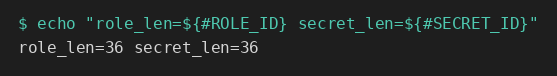
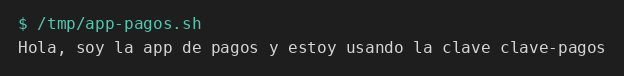
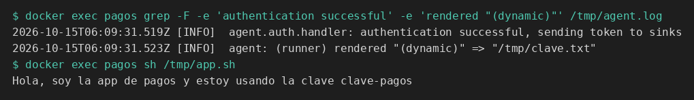
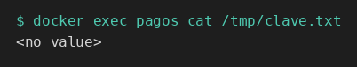

# Consumo automático

[← Página anterior](00-integrar-aplicacion.md) · [Siguiente página →](02-lab-job-falla-cerrado.md)

Vas a dejar dos aplicaciones que usan la misma clave. Una llama a la API de Vault. La otra corre en el contenedor `pagos` y solo lee el fichero que escribe Vault Agent.

### Objetivo

`/tmp/app-pagos.sh` imprime `Hola, soy la app de pagos y estoy usando la clave clave-pagos`. Dentro del contenedor `pagos`, `sh /tmp/app.sh` imprime esa misma frase.

### Punto de partida

```bash
bash infra/reiniciar-vault.sh
source infra/entorno.sh
```

Servidor vacío. AppRole se habilita en el paso 1. El contenedor `pagos` se crea en el paso 4. No reutilices identificadores de otro laboratorio: el reinicio los ha borrado.

### En qué consiste

Preparar secreto, policy y rol. Escribir la app que llama a la API y ejecutarla. Arrancar la máquina de la app, dejar ahí a Agent y ejecutar la app que lee el fichero.

### 1 — Secreto, policy y rol

**Acción:**

```bash
vault kv put secret/pagos/api clave=clave-pagos
bash infra/policy.sh solo-pagos <<'EOF'
path "secret/data/pagos/api" {
  capabilities = ["read"]
}
path "secret/metadata/pagos/api" {
  capabilities = ["read"]
}
path "sys/internal/ui/mounts/secret/*" {
  capabilities = ["read"]
}
EOF
vault auth enable approle
vault write auth/approle/role/pagos \
  token_policies=solo-pagos \
  token_ttl=15m \
  token_max_ttl=1h
ROLE_ID=$(vault read -field=role_id auth/approle/role/pagos/role-id)
SECRET_ID=$(vault write -f -field=secret_id auth/approle/role/pagos/secret-id)
export ROLE_ID SECRET_ID
echo "role_len=${#ROLE_ID} secret_len=${#SECRET_ID}"
```

**Por qué:** las dos apps solo conocerán estos dos identificadores. La que llama a la API los hereda de esta terminal. Agent los leerá de fichero, en el paso 5. Si le pasas `VAULT_TOKEN=root` a la app, no estás probando la integración.

**Resultado esperado:** `role_len=36 secret_len=36`.



### 2 — Escribe la app que llama a la API

**Acción:**

```bash
cat > /tmp/app-pagos.sh <<'EOF'
#!/usr/bin/env bash
set -euo pipefail
login=$(curl -sS --request POST \
  --data "{\"role_id\":\"${ROLE_ID}\",\"secret_id\":\"${SECRET_ID}\"}" \
  "${VAULT_ADDR}/v1/auth/approle/login")
token=$(printf '%s' "$login" | python3 -c 'import json,sys; print(json.load(sys.stdin)["auth"]["client_token"])')
clave=$(curl -sS --header "X-Vault-Token: ${token}" \
  "${VAULT_ADDR}/v1/secret/data/pagos/api" \
  | python3 -c 'import json,sys; print(json.load(sys.stdin)["data"]["data"]["clave"])')
echo "Hola, soy la app de pagos y estoy usando la clave ${clave}"
EOF
chmod +x /tmp/app-pagos.sh
```

**Por qué:** este fichero es la aplicación. Login, lectura y uso de la clave. El token vive en una variable local y no se imprime. Corre en tu terminal, que en este camino es la máquina del proceso.

**Resultado esperado:** el fichero existe y es ejecutable. Todavía no ha llamado a Vault.

### 3 — Ejecuta la app

**Acción:**

```bash
/tmp/app-pagos.sh
```

**Por qué:** este es el camino en el que la aplicación habla con Vault. El módulo 6 parte de este mismo gesto y lo rompe.

**Resultado esperado:** `Hola, soy la app de pagos y estoy usando la clave clave-pagos`.



> [!WARNING]
> Si el script falla con `ROLE_ID`, las variables se perdieron al cambiar de terminal. Repite las dos líneas `ROLE_ID=$(...)` y `SECRET_ID=$(...)` y el `export`. No hace falta reescribir el script.

### 4 — Arranca la máquina de la aplicación

**Acción:**

```bash
docker rm -f pagos >/dev/null 2>&1 || true
RED=$(docker inspect -f '{{range $k, $v := .NetworkSettings.Networks}}{{$k}}{{"\n"}}{{end}}' vault-dev | head -n 1)
echo "red=$RED"
docker run -d --name pagos --network "$RED" --entrypoint sleep hashicorp/vault:1.18 86400
```

**Por qué:** `pagos` es el sitio de la aplicación, en la misma red Docker que `vault-dev`. `sleep` mantiene el contenedor encendido; no es la app. Agent va a correr aquí, no dentro del servidor. Desde este contenedor, `127.0.0.1` es él mismo, así que la dirección de Vault será `http://vault-dev:8200`.

**Resultado esperado:** `red=` muestra un nombre (en este laboratorio, `infra_default`) y `docker run` imprime un id de contenedor.

### 5 — Deja los ficheros en esa máquina

**Acción:**

```bash
printf '%s' "$ROLE_ID" | docker exec -i pagos tee /tmp/role_id >/dev/null
printf '%s' "$SECRET_ID" | docker exec -i pagos tee /tmp/secret_id >/dev/null
docker exec -i pagos tee /tmp/app.sh >/dev/null <<'EOF'
#!/bin/sh
if [ ! -s /tmp/clave.txt ]; then
  echo "no hay fichero de secreto" >&2
  exit 1
fi
clave=$(cat /tmp/clave.txt)
echo "Hola, soy la app de pagos y estoy usando la clave ${clave}"
EOF
docker exec -i pagos tee /tmp/agent.hcl >/dev/null <<'EOF'
pid_file = "/tmp/vault-agent.pid"

vault {
  address = "http://vault-dev:8200"
}

auto_auth {
  method "approle" {
    config = {
      role_id_file_path = "/tmp/role_id"
      secret_id_file_path = "/tmp/secret_id"
      remove_secret_id_file_after_reading = false
    }
  }
}

template {
  contents = "{{ with secret \"secret/data/pagos/api\" }}{{ .Data.data.clave }}{{ end }}"
  destination = "/tmp/clave.txt"
}
EOF
```

**Por qué:** `agent.hcl` es toda la configuración de Agent. `auto_auth` hace el login con los ficheros `role_id` y `secret_id`. `template` escribe solo la clave en `/tmp/clave.txt`. `app.sh` lee ese fichero y construye la frase. `remove_secret_id_file_after_reading = false` deja el `secret_id` en disco para poder arrancar Agent otra vez en esta misma página.

**Resultado esperado:** los `tee` terminan sin texto.

### 6 — Arranca Agent y ejecuta la app del fichero

**Acción:**

```bash
docker exec -d pagos sh -c 'vault agent -config=/tmp/agent.hcl > /tmp/agent.log 2>&1'
for _i in 1 2 3 4 5 6 7 8 9 10; do
  docker exec pagos test -s /tmp/clave.txt && break
  sleep 1
done
docker exec pagos grep -F -e 'authentication successful' -e 'rendered "(dynamic)"' /tmp/agent.log
docker exec pagos sh /tmp/app.sh
```

**Por qué:** las dos líneas del log son el mecanismo. `authentication successful` es el login AppRole. `rendered "(dynamic)" => "/tmp/clave.txt"` es la plantilla ya escrita. La app no ha hablado con Vault: ha leído el fichero. El log está en un fichero porque el proceso principal de `pagos` es `sleep`; `docker logs pagos` no muestra a Agent.

**Resultado esperado:** el `grep` enseña esas dos frases, y la app imprime `Hola, soy la app de pagos y estoy usando la clave clave-pagos`. El bucle no agota los 10 intentos.



> [!WARNING]
> Al terminar la página, quita la máquina de la app: `docker rm -f pagos`. Si la dejas, Agent sigue renovando el token. `bash infra/reiniciar-vault.sh` también la elimina.

## Comprueba tu entendimiento

**La app del fichero no nombra a Vault**
`docker exec pagos cat /tmp/app.sh`
→ El script lee `/tmp/clave.txt` y escribe la frase. No aparecen `VAULT_ADDR`, `role_id` ni un token.

**Campo que no existe**
Para Agent, vuelve a escribir `/tmp/agent.hcl` con `.Data.data.password` en lugar de `.Data.data.clave`. Para el proceso viejo y arranca otro:

```bash
docker exec pagos sh -c 'if [ -f /tmp/vault-agent.pid ]; then kill $(cat /tmp/vault-agent.pid) || true; fi'
docker exec pagos rm -f /tmp/clave.txt /tmp/vault-agent.pid
docker exec -i pagos tee /tmp/agent.hcl >/dev/null <<'EOF'
pid_file = "/tmp/vault-agent.pid"

vault {
  address = "http://vault-dev:8200"
}

auto_auth {
  method "approle" {
    config = {
      role_id_file_path = "/tmp/role_id"
      secret_id_file_path = "/tmp/secret_id"
      remove_secret_id_file_after_reading = false
    }
  }
}

template {
  contents = "{{ with secret \"secret/data/pagos/api\" }}{{ .Data.data.password }}{{ end }}"
  destination = "/tmp/clave.txt"
}
EOF
docker exec -d pagos sh -c 'vault agent -config=/tmp/agent.hcl > /tmp/agent.log 2>&1'
for _i in 1 2 3 4 5 6 7 8 9 10; do
  docker exec pagos test -s /tmp/clave.txt && break
  sleep 1
done
docker exec pagos cat /tmp/clave.txt
echo
```

→ El fichero contiene `<no value>`. La plantilla imprime eso cuando el campo no existe. El login ha funcionado: el fallo es el nombre del campo.



## Reto

### 1 — La app de la API tras una rotación

Escribe la versión 2 con `clave=clave-nueva` y ejecuta otra vez `/tmp/app-pagos.sh` sin tocar el script.

<details>
<summary>Ver solución</summary>

```bash
vault kv put secret/pagos/api clave=clave-nueva
/tmp/app-pagos.sh
```

Imprime `Hola, soy la app de pagos y estoy usando la clave clave-nueva`. El script no tiene la clave escrita dentro: la pide cada vez.


</details>

## Errores frecuentes

| Síntoma | Causa probable | Cómo arreglarlo |
|---------|----------------|-----------------|
| `ROLE_ID: unbound variable` | No exportaste los ids en esta terminal | Repite el final del paso 1 |
| `connection refused` en `/tmp/agent.log` | `vault.address` es `127.0.0.1` dentro de `pagos` | Tiene que ser `http://vault-dev:8200` |
| Agent: `permission denied` al renderizar | El rol no tiene `solo-pagos` o la policy no lleva `secret/data/` | `vault read auth/approle/role/pagos` y `vault policy read solo-pagos` |
| La app imprime `no hay fichero de secreto` | Agent no ha llegado a renderizar | `docker exec pagos cat /tmp/agent.log` |
| El fichero tiene `<no value>` | La plantilla no usa `.Data.data.clave` | Vuelve a copiar el bloque `template` del paso 5 |
